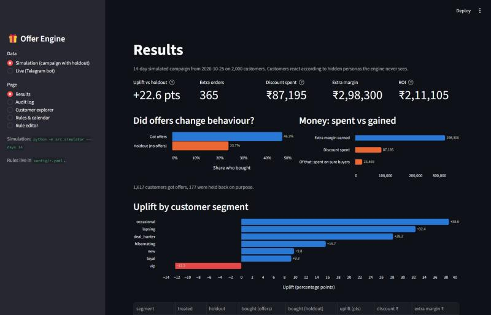
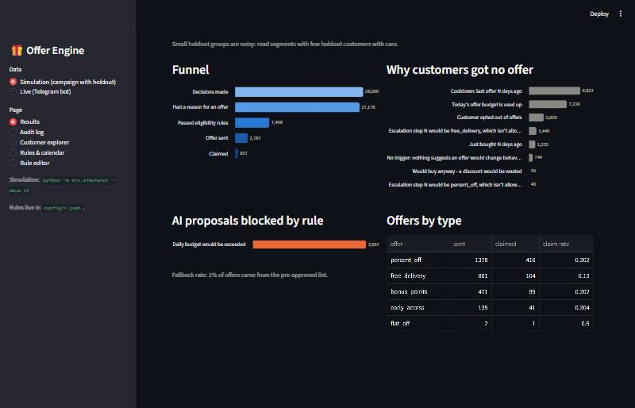
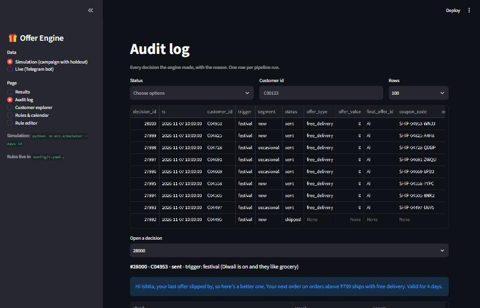
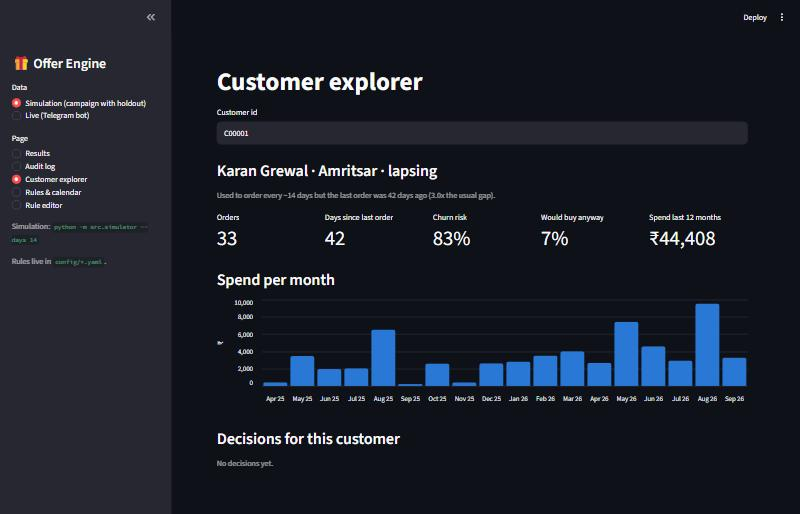
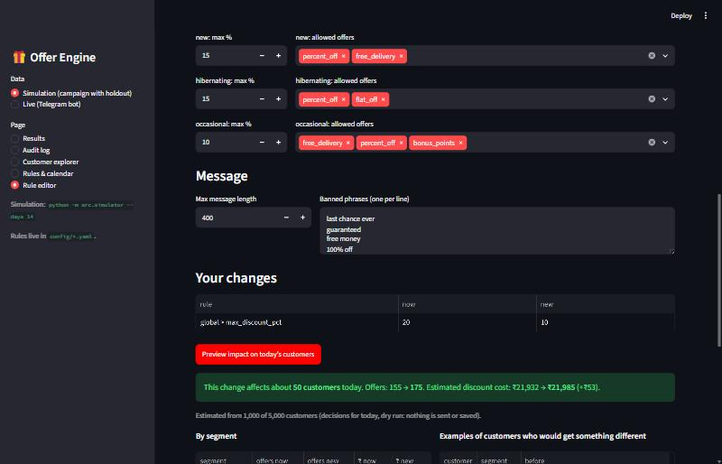

# Personalised Offer Engine

**Only spend a discount when it changes behaviour.**

For each customer of an (entirely synthetic) Indian online store, this engine decides **whether to
send an offer, which one, and when**, and delivers it through one Telegram bot. Rules set the limits,
Claude chooses and personalises the offer within them, and plain Python code checks every offer
before it is sent. The AI is never the judge of its own output.

*Punjab Jobs AI Bootcamp · J-PAL South Asia · Hackathon 2*



## Highlights

| | |
|---|---|
| **It pays** | 14-day simulation with a 10% holdout: **+22.6 points uplift** (46.3% vs 23.7% bought), 365 extra orders, ROI **+₹2,11,105** |
| **It never breaks a rule** | 15 deterministic checks on every offer; a "chaos AI" and ~30 red-team attacks (90% off, lying numbers, hidden characters, prompt injection in a customer's name) never get through |
| **Marketing stays in control** | All limits in plain-English YAML, plus a rule editor that previews *"affects 50 customers, cost ₹21,932 → ₹21,985"* before saving |
| **Personal, in their language** | Win-backs in English, Hinglish or Punjabi ("Sat Sri Akal Manjot ji!"), festival-aware (Diwali, Karwa Chauth, Lohri, Baisakhi, Gurpurab) |
| **Realistic data** | 5,000 customers, 8 hidden personas, 18 months, 24/24 realism checks (Pareto spend, Gamma purchase gaps, Diwali spike, COD in smaller cities) |
| **Explains itself** | Every decision is logged; `/why` in Telegram and the dashboard's audit log say why an offer was (or wasn't) sent |

An offer card in Telegram (written by Claude, checked by the rules):

> **We miss you, Manjot!**
>
> Sat Sri Akal Manjot ji! It's been 38 days and we've really missed you. Come back to fashion with
> 15% off on orders of ₹999 or more. Valid for 6 days 😊
>
> 🎁 **15% off fashion on orders above ₹999 (up to ₹500)**
> ⏳ Valid till Thu 29 Oct · 🔖 Code: `PCT15-00503-NDCM`
>
> [Claim 🎁] [Not now] [Why this offer?]

## Quick start (Windows)

```
python -m venv .venv
.venv\Scripts\activate
pip install -r requirements.txt
copy .env.example .env                                   # add your Telegram token and Anthropic key
python -m src.generate_data --customers 5000 --seed 42   # synthetic store (about 45 s)
python -m src.bot                                        # Telegram bot
streamlit run dashboard/app.py                           # marketing dashboard
python -m src.simulator --days 14                        # does it pay? (about 4 min)
pytest -q                                                # 275 tests
```

Without an Anthropic key everything still works: a rule-based agent writes the offers.

## How it works

Every decision passes through 10 steps (one Python function each, in `src/engine/nodes.py`) and
writes one row to the audit log:

```
1 Load customer → 2 Detect trigger → 3 Segment & score → 4 Eligibility (rules) ──not eligible / holdout──→ 9 Skip
                                                              │
                                5 Claude picks an offer → 6 Guardrail validator ──fails / timeout──→ 10 Safe fallback
                                                              │                                          │
                                                     7 Send on Telegram ◄──────────────────────────────┘
                                                              │
                                                     8 Track & learn (follow-ups if ignored)
```

- **Triggers:** lapsed buyer, abandoned cart, points expiring, birthday, festival, new customer, long
  inactive, browsing without buying, payday, follow-up.
- **Who gets nothing:** opted out, holdout (control group), cooldown, just bought, "would buy anyway",
  budget used up, kill switch. When the budget is limited, the most valuable likely churners go first.
- **Claude** sees only the options the rules allow; its answer must be one of them, in strict JSON.
- **The validator** (plain Python, no AI) checks offer type, discount caps, flat cap, minimum order,
  budget, eligibility, expiry, profit after discount, and the message (length, banned phrases, numbers
  match the offer, no other customer's data, no invented claims, codes or links).
- **Follow-ups:** an ignored offer is followed by free delivery, then 10%, then 15%, then stop.
  "Not now" is respected.

## Telegram bot

Run `python -m src.bot`, open the bot, send `/start` and pick a shopper type.

| Command | What it does |
|---|---|
| `/myoffer` | Runs the full engine for you now and shows the offer card (or why there is none) |
| `/why` | Why you got (or didn't get) your last offer, in plain words |
| `/history` | Your last 5 offers and what you did with them |
| `/timetravel N` | Demo: jump N days ahead to see offers expire and follow-ups kick in |
| `/persona` | Become a different customer |
| `/stop` / `/resume` | Opt out of / back into offers |
| `/whoami` | Your chat id (for `ADMIN_CHAT_IDS`) |

**Admins** (chat ids in `ADMIN_CHAT_IDS`): `/admin` (today's stats with Pause / Resume buttons),
`/audit C00123` (one customer's decision trail), `/pause` / `/unpause` (kill switch).

The bot runs a scheduler every 10 minutes: it expires offers, delivers offers held back by quiet hours
(10pm-8am) at the customer's usual shopping hour, and pushes follow-ups.

## Dashboard

`streamlit run dashboard/app.py`, then pick the data source (simulation or live bot) in the sidebar.

| Page | Shows |
|---|---|
| **Results** | Uplift vs holdout, money spent vs gained, uplift by segment, funnel, why customers got no offer, which rules blocked the AI |
| **Audit log** | Every decision with its reason; open one to see all 15 rule checks |
| **Customer explorer** | A customer's segment and reason, churn risk, monthly spend, decisions |
| **Rules & calendar** | Current limits, segment rules, follow-up ladder, upcoming festivals |
| **Rule editor** | Change limits, preview the impact on today's customers, then save |

| Funnel and blocked rules | Audit log |
|---|---|
|  |  |
| **Customer explorer** | **Rule editor with preview** |
|  |  |

## Changing the rules (no coding needed)

| File | What it controls |
|---|---|
| `config/rules.yaml` | Every limit: max discount, category and segment caps, daily budget, cooldown, holdout %, quiet hours, expiry, follow-up ladder, banned phrases and claims |
| `config/offers.yaml` | Pre-approved fallback offers, their messages, and card headlines |
| `config/segments.yaml` | How customers are grouped and which triggers count |
| `config/occasions.yaml` | Festival calendar: dates, demand boost, budget multiplier, theme |
| `src/prompts/offer_agent.md` | The instructions Claude follows (tone, language, what never to write) |

Each value has a plain-English comment. Edit the files directly or use the dashboard's **Rule editor**,
which validates the change, previews its impact, keeps all comments, and backs up the old file in
`config/history/`. A typo or out-of-range value is rejected with a clear message. The bot picks up
saved rules on its next decision.

## Does it pay? (simulation)

`python -m src.simulator --days 14` runs the real engine day by day on a copy of the database and
lets customers react according to hidden personas the engine never sees. 10% are held back.

- **uplift** = share who bought with offers − share who bought in the holdout
- **ROI** = extra margin from the extra orders − discount money spent

Example (2,000 customers, 14 days): **+22.6 points uplift**, 365 extra orders, ₹87,195 spent
(₹23,469 of it on people who would have bought anyway), ₹2,98,300 extra margin, **ROI +₹2,11,105**.
Lapsed regulars (+32 pts) and occasional buyers (+39 pts) respond most; VIPs show no uplift because
they buy anyway, which is why the rules give them points and early access instead of discounts.

## The synthetic data

`python -m src.generate_data --customers 5000 --seed 42` creates 18 months of history for 5,000
customers in Punjab cities and metros, driven by 8 hidden personas (VIP, loyal, lapsing, deal hunter,
cart abandoner, window shopper, new, hibernating): ~100k orders, ~430k sessions, ~300k cart events.
`python scripts/validate_data.py` prints the realism checks (24/24 pass). The engine only uses
behaviour; `python -m src.segments` shows its segments match the hidden personas 80-100%.

## Safety and testing

- `pytest -q` runs 275 tests in about 5 minutes.
- `tests/test_redteam.py` attacks the system on purpose: 90% off, offers off the AI's menu, text that
  lies about numbers ("fifty percent", "half price", "₹5k", fullwidth or Devanagari digits, invented
  dates), hidden zero-width characters, made-up coupon codes, cashback or free-iPhone claims, other
  customers' names, links, broken JSON, and a customer whose *name* is a prompt-injection attack.
  All are blocked; safe English, Hinglish and Punjabi messages still pass.
- A "chaos agent" test proposes random offers for every customer: no rule-breaking offer is ever sent.
- Secrets live only in `.env` (git-ignored) and are never logged.

## All commands

```
python -m src.generate_data --customers 5000 --seed 42
python scripts/validate_data.py
python -m src.segments
python -m src.engine.pipeline --customer C00001             # one decision, every step explained
python -m src.engine.pipeline --sample 500                  # many customers (dry run unless --write)
python -m src.engine.pipeline --customer C00001 --agent claude
python -m src.scheduler                                     # one scheduler round (dry run unless --write)
python -m src.simulator --days 14
python -m src.bot
streamlit run dashboard/app.py
pytest -q
```

If Python shows SSL certificate errors (antivirus or proxy), make sure `truststore` from
`requirements.txt` is installed. The design notes are in `CLAUDE.md`; a presentation walkthrough is in
`docs/DEMO.md`.
